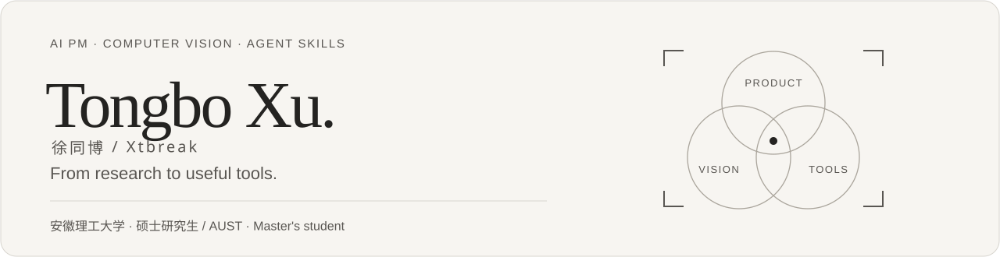

  <a href="https://xtbreak.github.io/Xtbreak/">个人网站 / Website</a> &nbsp; · &nbsp;
  <a href="https://github.com/Xtbreak?tab=repositories">项目仓库 / Repositories</a> &nbsp; · &nbsp;
  <a href="mailto:xtborin@gmail.com">联系我 / Email</a>

## About me

I'm **Tongbo Xu**, an **AI PM** researching **computer vision**. **Anhui University of Science and Technology · Master's**. My projects span AI desktop companions, practical software, interactive web experiences and reusable Agent Skills.

## Applications

| Project | Overview | Star |
| :--- | :--- | :---: |
| **[Paper2Talk](https://github.com/Xtbreak/Paper2Talk)** | A conversational workspace that turns research topics and papers into editable presentations with source figures, citations and speaker notes. |  |
| **[Product Manager Workbench](https://github.com/Xtbreak/product-manager-workbench)** | A desktop workspace for project materials, PRDs and AI assistants, from requirements to acceptance. |  |
| **[DesktopPet](https://github.com/Xtbreak/DesktopPet)** | A macOS AI desktop companion with character interaction, text conversations, long-term memory and character-specific personas. A personal, non-commercial demo. | Private |
| **[Heybox Universe](https://github.com/Xtbreak/heybox-universe)** | A game-themed interactive web experience built with Three.js. An unofficial, non-commercial course concept demo. |  |

## Agent Engineering

| Project | Overview | Star |
| :--- | :--- | :---: |
| **[PRD ↔ Code](https://github.com/Xtbreak/prd-code)** | Turns an agent idea into a product requirements document (PRD) and an architecture plan. For existing projects, it scans the code and highlights gaps between the implementation and the PRD. |  |
| **[Dev-Framework](https://github.com/Xtbreak/Dev-Framework)** | A step-by-step guide to building AI products with coding agents, from requirements through implementation, testing and deployment. |  |
| **[Personal Agent](https://github.com/Xtbreak/Personal-Agent)** | A personal assistant foundation with long-term memory, drafting, reminders and confirmation before consequential actions. |  |

## Tools

| Project | Overview | Star |
| :--- | :--- | :---: |
| **[CampusConnect](https://github.com/Xtbreak/CampusConnect)** | A Windows / macOS auto-login tool for Anhui University of Science and Technology campus network (telecom / mobile / unicom), with tray/menu bar and reconnect. |  |
| **[MediaHub](https://github.com/Xtbreak/MediaHub)** | A local media resource platform for videos, scores, articles, announcements, banners and user permissions (React + Express + MySQL). | Private |
| **[寻馆](https://github.com/Xtbreak/xunguan)** | A museum-collection lookup web app (photo + clues → Dify), ink-and-stone design. | Private |

## Skills

| Project | Overview | Star |
| :--- | :--- | :---: |
| **[ToPRD-skill](https://github.com/Xtbreak/ToPRD-skill)** | Creates AI product PRDs from ideas or existing projects, with optional implementation guides and project-specific interview Q&A. |  |
| **[lecture-manuscript](https://github.com/Xtbreak/lecture-manuscript)** [Guide](https://xtbreak.github.io/lecture-manuscript/) | Turns class transcripts and slides into concise Chinese study notes, preserving key examples, steps and diagrams. |  |
| **[visual-research-report-skill](https://github.com/Xtbreak/visual-research-report-skill)** | Turns research and option comparisons into continuous-scroll HTML reports with a Markdown companion. |  |

## Skills

### Product

### Engineering

## 文章

| 文章 | 简介 |
| :--- | :--- |
| **[AI 产品经理的幻灭与旧世界崩塌](https://mp.weixin.qq.com/s/xaE4N5pzvhqohViHwmlHbg)** | 从企业知识库助手向客户推荐竞品说起，分析模型回答为什么难以预测，以及反复给提示词加规则会带来哪些新问题。 |
| **[Claude Code 能上车的正规渠道全评测](https://mp.weixin.qq.com/s/UxXXmakDibp9JJj6A-B_Ow)** | 比较 9 个使用高阶 Claude 模型的渠道，逐一评估费用、支付门槛，以及购买的额度能否用于自己的客户端或终端。 |
| **[为什么在 AI 时代 Obsidian 才是最好的笔记软件](https://mp.weixin.qq.com/s/ee-FGK-JbAx2Gma1YzCbXA)** | 从 Obsidian 把笔记存为本地 Markdown 文件讲起，说明如何让 AI 工具检索、整理旧笔记，同时自己决定哪些内容可以离开电脑。 |
| **[翻完 Anthropic 335 页招股书](https://mp.weixin.qq.com/s/hTH5tWA1_2i25GKrkgDlOA)** | 从招股书里的净亏损入手，拆解可转债估值变动如何影响账面数字，再看企业 API 客户如何支撑收入增长。 |

---
